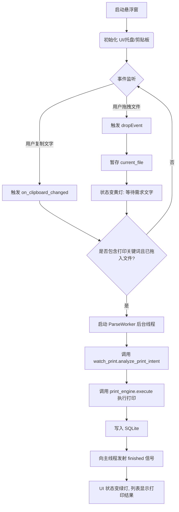
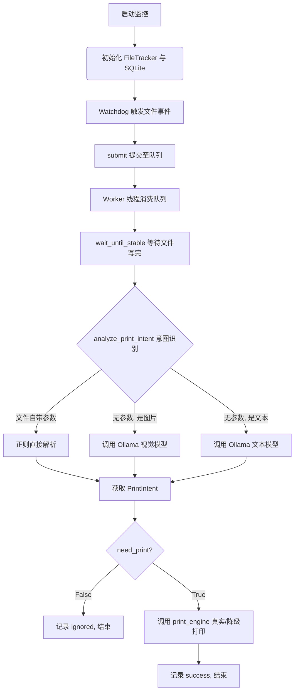

# AI 打印管家

面向传统打印店的本地智能化接单助手。店长可以通过桌面悬浮窗接收拖拽的文件，系统自动结合剪贴板文字或图片内容，解析打印参数，并调用底层打印引擎进行真实打印（无实体机时自动降级为静默输出 PDF），极大减少前台重复操作。

当前版本已具备**桌面悬浮窗交互**、**剪贴板无感监听**、**文件夹监控**、**本地 Ollama 多模态意图识别**、**双轨制打印引擎**与 **SQLite 日志落库**能力，定位为店内可离线运行的第一阶段原型。

## 📁 核心文件结构

- `floating_window.py`：**前端交互层**。基于 PyQt5 的桌面悬浮窗，负责接收文件拖拽、监听系统剪贴板、展示处理历史。
- `watch_print.py`：**调度与解析引擎**。包含 watchdog 目录监控、多线程队列、正则校验、Ollama 大模型调用以及 SQLite 数据库落库。
- `print_engine.py`：**底层打印引擎**。实现文件格式归一化（统一转 PDF），并通过“双轨制”策略处理真实打印或降级输出。
- `test_watch_print.py`：**单元测试**。基于 pytest 针对核心逻辑（正则、校验）进行回归测试。

---

## 🏗️ 核心架构与流程图

### 1. 整体业务数据流
店长拖入文件 + 复制文字需求 ➡️ 解析引擎提取结构化参数 ➡️ 打印引擎处理文件格式 ➡️ 落库并反馈 UI。

### 2. `floating_window.py` (GUI 交互流)

基于 PyQt5 的事件驱动模型，所有的耗时操作都放入 `QThread` 后台线程，防止主界面卡死。



### 3. `watch_print.py` (后台监控与解析流)

作为纯后台守护进程，支持 watchdog 监控或轮询。



### 4. `print_engine.py` (双轨制打印引擎流)

屏蔽底层 OS 差异，保证在无实体机的开发环境下也能完成闭环验证。

```mermaid
graph TD
    A[接收文件 file_path] --> B{环境探测}
    
    B -->|无实体打印机| C[模式 A: 降级通道]
    B -->|有实体打印机| D[模式 B: 真实打印通道]
    
    C --> E[统一格式归一化]
    D --> E
    
    E --> F{判断文件格式}
    F -->|图片| G[用 PIL 转换为临时 PDF]
    F -->|Office| H[用 win32com 转临时 PDF]
    F -->|PDF| I[直接透传]
    
    G --> J{当前处于哪种模式?}
    H --> J
    I --> J
    
    J -->|模式 A| K[复制 PDF 到桌面 (带时间戳)]
    J -->|模式 B| L[调用 SumatraPDF 静默打印]
    
    L -->|打印失败 (卡纸/离线)| M[触发降级]
    M --> K
    
    K --> N[清理临时文件]
    L --> N
    N --> O[返回成功或降级状态]
```

---

## ✨ 已实现功能

### 交互与捕获层 (`floating_window.py`)
| 能力 | 说明 |
| --- | --- |
| **桌面悬浮窗** | 使用 PyQt5 实现无边框、半透明的桌面悬浮挂件，支持自由拖拽移动。 |
| **文件拖拽接收** | 支持从微信/资源管理器直接将文件拖入窗口，暂存待处理。 |
| **剪贴板无感监听** | 店长只需在微信选中并复制客户的需求文字（如“打1份彩印”），悬浮窗自动捕获，与拖入的文件即时绑定并解析。 |
| **手动读取兜底** | 若剪贴板被其他软件拦截，提供手动读取按钮，确保业务不断档。 |

### 打印引擎层 (`print_engine.py`)
| 能力 | 说明 |
| --- | --- |
| **环境探测** | 自动识别系统是否有实体打印机，以及是否有 SumatraPDF 静默打印工具。 |
| **统一格式归一化** | 抹平差异，将图片 (PIL)、Office 文档 (COM接口) 统一转换为临时 PDF。 |
| **双轨制执行** | **模式 A（无实体机）**：静默复制 PDF 到桌面验证闭环；**模式 B（有实体机）**：调起 SumatraPDF 无感出纸。 |
| **失败降级兜底** | 模式 B 打印失败时（如卡纸、离线），自动降级为模式 A 保存文件至桌面，绝不丢失客户文件。 |

### 解析引擎层 (`watch_print.py`)
| 能力 | 说明 |
| --- | --- |
| **多模态视觉识别** | 遇到图片时自动调用 `qwen2.5vl`，不仅能看图猜测，还能提取图内文字指令。 |
| **文本优先拦截** | 捕捉到明确文字需求时，优先走正则解析（毫秒级）；失败才降级调用大模型。 |
| **并发安全落库** | 使用 SQLite WAL 模式将所有处理记录写入 `print_logs.db`，支持多线程并发。 |
| **防抖与重试** | 写入完成检测防半截文件；模型调用失败采用指数退避重试机制。 |

---

## 🚀 快速开始

```powershell
# 1. 安装依赖
pip install -r requirements.txt
ollama serve

# 2. 拉取模型
ollama pull qwen2.5:3b
ollama pull qwen2.5vl:3b

# 3. 启动桌面悬浮窗（推荐日常使用，支持拖拽与剪贴板）
python floating_window.py

# 或者：纯后台启动目录监控（拖入 C:\打印接收 文件夹触发）
python watch_print.py --dir "C:\打印接收"
```

## 🧪 单元测试

本项目使用 `pytest` 进行核心逻辑的回归测试。运行以下命令可验证正则解析与参数校验逻辑：

```powershell
pip install pytest
pytest test_watch_print.py -v
```