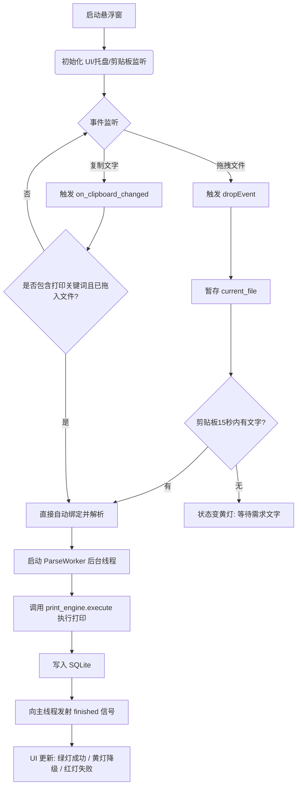
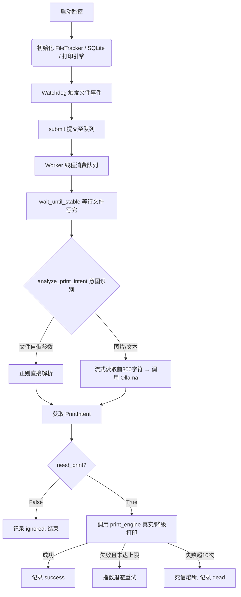
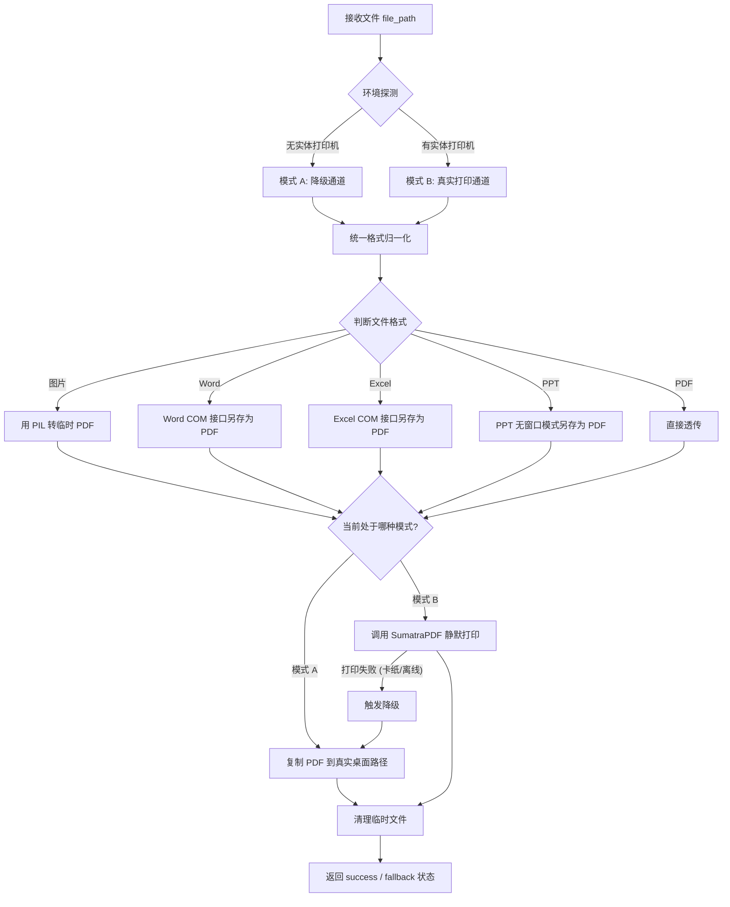

# AI 打印管家

面向传统打印店的本地智能化接单助手。店长可以通过桌面悬浮窗接收拖拽的文件，系统自动结合剪贴板文字或图片内容，解析打印参数，并调用底层打印引擎进行真实打印（无实体机时自动降级为静默输出 PDF），极大减少前台重复操作。

当前版本已具备**桌面悬浮窗交互**、**剪贴板无感监听**、**文件夹监控**、**本地 Ollama 多模态意图识别**、**双轨制打印引擎**与 **SQLite 日志落库**能力，并针对真实生产环境进行了深度防呆与容错设计，定位为店内可离线运行的商业级第一阶段原型。

## 📁 核心文件结构

- `floating_window.py`：**前端交互层**。基于 PyQt5 的桌面悬浮窗，负责接收文件拖拽、监听系统剪贴板（带时序防串台机制）、多线程状态管理与展示处理历史。
- `watch_print.py`：**调度与解析引擎**。包含 watchdog 目录监控、多线程队列、OOM防护、正则校验、Ollama 大模型调用、死信熔断机制以及 SQLite 数据库落库。
- `print_engine.py`：**底层打印引擎**。实现文件格式归一化（统一转 PDF），跨应用 COM 调用（Word/Excel/PPT），支持 OneDrive 路径探测，并通过“双轨制”策略处理真实打印或降级输出。
- `test_watch_print.py`：**单元测试**。基于 pytest 针对核心逻辑（正则、校验）进行回归测试。

---

## 🏗️ 核心架构与流程图

### 1. 整体业务数据流
店长拖入文件 + 复制文字需求 ➡️ 解析引擎提取结构化参数 ➡️ 打印引擎处理文件格式 ➡️ 落库并反馈 UI。

### 2. `floating_window.py` (GUI 交互流)

基于 PyQt5 的事件驱动模型，耗时操作全在 `QThread` 后台执行，且加入了**剪贴板 15 秒时序防抖**，杜绝历史脏数据误打。



### 3. `watch_print.py` (后台监控与解析流)

包含流式读取防 OOM、死信熔断防死循环、以及真实的打印引擎路由。



### 4. `print_engine.py` (双轨制打印引擎流)

屏蔽底层 OS 差异，修复了 Office COM 接口，保证在无实体机的开发环境下也能完成闭环验证。



---

## ✨ 已实现功能

### 交互与捕获层 (`floating_window.py`)
| 能力 | 说明 |
| --- | --- |
| **桌面悬浮窗** | 无边框、半透明挂件，支持自由拖拽移动，具备系统托盘常驻能力。 |
| **双向触发绑定** | 支持“先拖文件后复制”与“先复制后拖文件”两种顺序，内置 15 秒时序防串台机制。 |
| **手动读取兜底** | 若剪贴板信号被输入法或其他软件拦截，提供手动读取按钮确保业务不断档。 |

### 打印引擎层 (`print_engine.py`)
| 能力 | 说明 |
| --- | --- |
| **环境与路径探测** | 自动识别实体机状态；通过读取 Windows 注册表获取真实桌面路径（兼容 OneDrive 重定向）。 |
| **统一格式归一化** | 抹平差异，将图片 (PIL)、Word (SaveAs)、Excel (ExportAsFixedFormat)、PPT (WithWindow=False) 统一转为临时 PDF。 |
| **双轨制执行** | 模式 A（静默复制 PDF 到桌面）；模式 B（调起 SumatraPDF 无感出纸）。 |
| **失败降级兜底** | 模式 B 打印失败时，自动降级保存文件至桌面，绝不丢失客户文件，并返回 `fallback` 状态。 |

### 解析与调度层 (`watch_print.py`)
| 能力 | 说明 |
| --- | --- |
| **多模态视觉识别** | 遇到图片自动调用 `qwen2.5vl`，不仅能看图猜测，还能提取图内文字指令。 |
| **死信熔断与防抖** | 采用指数退避重试（上限 60s），超 10 次失败自动熔断（标记 Dead），防止坏文件造成死循环；利用文件大小与修改时间实现防半截文件打纸。 |

---

## 🛡️ 生产级高可用与防呆设计（核心工程亮点）

本项目在重构阶段，针对真实环境中的边缘情况进行了深度的架构防御：

1. **杜绝 OOM（内存溢出）**：文本预览强制使用文件流 `f.read(N)` 按需读取前 800 字符，拒绝大文件 `read_bytes()` 全量加载导致系统崩溃。
2. **QThread 生命周期管理**：前端使用 `worker` 集合持有线程引用，防止高频拖拽时后台线程被 Python 垃圾回收（GC）导致程序闪退。
3. **状态精准可观测**：严格区分 `success`（彻底成功）与 `fallback`（打印机异常存桌面）状态。UI 对应亮绿灯与黄灯，保证数据库报表真实可靠。
4. **全局单例与 UUID 并发安全**：`PrintEngine` 全局复用，避免反复探测环境；临时 PDF 生成采用 `uuid` 防多线程并发覆盖。

---

## 🚀 快速开始

```powershell
# 1. 安装依赖
pip install -r requirements.txt
ollama serve

# 2. 拉取模型
ollama pull qwen2.5:3b
ollama pull qwen2.5vl:3b

# 3. 启动桌面悬浮窗（推荐日常使用，支持拖拽与剪贴板）
python floating_window.py

# 或者：纯后台启动目录监控（拖入 C:\打印接收 文件夹触发）
python watch_print.py --dir "C:\打印接收"
```

## 🧪 单元测试

本项目使用 `pytest` 进行核心逻辑的回归测试。运行以下命令可验证正则解析与参数校验逻辑：

```powershell
pip install pytest
pytest test_watch_print.py -v
```